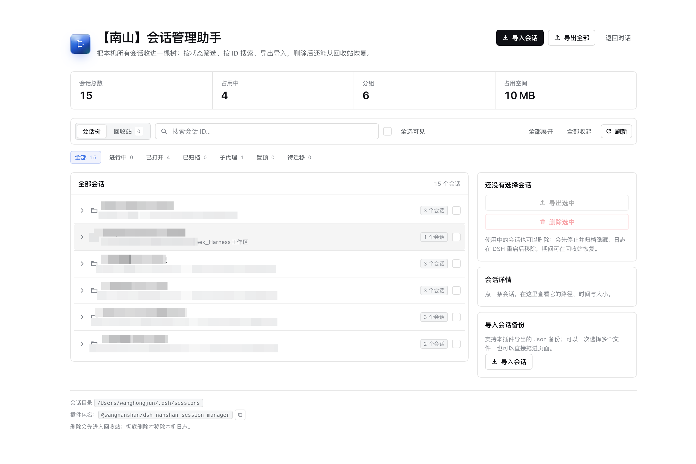

# 【南山】会话管理助手（`@wangnanshan/dsh-nanshan-session-manager`）

给 DeepSeek Harness 左侧栏加一个全局入口：把本机所有会话收进一棵树，按状态筛选、按会话 ID 搜索、导出导入，删除后还能从回收站恢复。

> 删除会先把会话放进回收站，可恢复；彻底删除才会移除本机日志。操作前仍建议导出备份。

> 界面采用现代极简的开发者工具 / SaaS 控制台风格：中性浅色、细边框、紧凑排版、单一强调色，并跟随 DSH 主题变量。插件标识使用蓝色液态玻璃树形图标。

## 功能



### 左侧栏入口

启动后在左侧栏出现「【南山】会话管理助手」图标，与「成长历程」等全局面板并列。点击进入管理页，不会打断当前对话；点「返回对话」回到原来的会话。

界面文案跟随系统语言：系统为中文（任何中文变体）时显示中文，系统为英文时显示英文。插件也向 DSH locale 注册了 `zh`、`zh-CN`、`zh-Hans`、`zh-Hant`、`zh-TW`、`zh-HK` 与 `en`、`en-US`、`en-GB` 字典。

### 树形会话列表

默认按三级结构浏览：

```text
全部会话
└─ 工作区 / 会话目录
   └─ 2026 年 11 月
      └─ 会话
```

- 工作区优先使用 DSH 的工作区名称；没有对应工作区的会话按 `cwd` 归到目录组。
- 每次进入插件默认把所有工作区分组收起；点工作区分组展开后，月份和会话按层级显示。进入后可用「全部展开 / 全部收起」调整本次浏览状态。
- **搜索只按会话 ID**（支持部分匹配），不再匹配标题、路径或工作区。
- 顶部状态筛选：全部、进行中、已打开、已归档、子代理、置顶、待迁移；每个筛选项带数量。
- 启用筛选时会自动展开命中的分组，避免结果被折叠隐藏。
- 顶部统计显示会话总数、占用中数量、分组数和日志占用空间。
- 会话标题加粗显示，便于在长列表中快速定位。
- 页面底部显示插件包名 `@wangnanshan/dsh-nanshan-session-manager`，旁边的小按钮可一键复制。
- 右侧详情卡显示工作区、目录、创建时间、最近活动、日志大小、轮次、代理预设和会话 ID；点击目录或 ID 可复制。

### 多选与批量操作

- 每一行、每个月、每个工作区都有选择框；工具栏支持「全选可见」。
- 选中后可以批量导出、批量删除、批量恢复或批量彻底删除。
- 全选包含正在使用的会话：确认后它们会先停止并归档隐藏，再进入延迟删除。

### 删除、回收站与恢复

删除分两层：

1. **移入回收站**：普通会话立即从会话树和原生侧栏消失，日志复制到插件回收站，可随时恢复。
2. **彻底删除**：只有回收站里的条目才能彻底删除，移除备份日志，不可恢复。

正在使用的会话（包括当前正在对话的会话）也可以删除：

- 先调用 DSH 工作区归档并停止该会话当前的工作；
- 会话立即从会话树和原生侧栏隐藏，进入回收站；
- 因为 DSH 仍持有内存句柄和写句柄，日志不会在运行期强删；会在 **DSH 重启后**（或该会话真正释放后）自动移入正常回收站，再删除原始日志；
- 在真正删除前都可以从回收站恢复；恢复会取消归档，会话回到原工作区。

从会话树删除后，提示条里会带一个「撤销」按钮，可直接恢复刚删除的批量会话。

### 导出

- 「导出全部」导出当前所有可读会话；「导出选中」只导出勾选项。
- 导出文件是一个 JSON 备份（`nanshan-sessions-*.json`），包含会话原始 `.jsonl.zstd` 日志的 base64、原始字节数、SHA-256、标题、工作区路径和创建时间。
- 导出正在运行的会话前会先尝试 `session/flush`，尽量把已提交但未落盘的事件写入日志。
- 导出使用 DSH 的原始日志字节，不改变日志内容，因此可以用本插件原样导回。

### 导入

- 支持点击「导入会话」选择 `.json`，也支持把备份文件直接拖进页面；一次可以选择多个文件。
- 导入时会校验：备份格式、会话 ID、SHA-256、Zstd 头、会话格式版本、工作区绝对路径、是否与已存在会话或进行中会话冲突。
- 成功导入的会话会写回原来的工作区目录；工作区仍存在时自动加入工作区成员关系，并清除旧的归档/置顶标记。
- 备份里的标题会记录到插件自己的标题旁路（见下文），所以即使投影缓存尚未重建，本页面也能显示标题。
- 导入完成后会自动刷新本页面和原生侧栏会话列表。
- 重复 ID、缺少原始日志、编码不匹配（例如备份是 zstd、当前 DSH 使用未压缩日志）等情况会跳过，并在页面顶部给出导入结果和原因。

### 打开会话

- 行内「打开」按钮或双击行会调用 DSH 的 `uiWorkspace.openSession()`，回到该会话的对话界面。
- 如果会话处于归档状态，会先尝试取消归档再打开。
- 若当前运行环境没有 `uiWorkspace` 服务，会给出提示，仍可继续在本页面管理。

## 数据在哪里

```text
$DSH_HOME/sessions/<project-key>/<encoded-session-id>/session.v4.jsonl.zstd
$DSH_HOME/storages/session_projcache/sessions/<session-id>.json
$DSH_HOME/nanshan-session-manager/titles.json
$DSH_HOME/nanshan-session-manager/trash/<trash-id>/manifest.json
$DSH_HOME/nanshan-session-manager/trash/<trash-id>/session.log
```

- 前两项是 DSH 自己的会话日志与投影缓存，插件只按 DSH 的路径规则读写。
- `titles.json` 是插件旁路，只保存导入时带来的标题，避免导入后标题暂时为空；删除会话时会同步处理对应条目。
- `trash/` 是插件的回收站。普通删除会立即复制日志到 `session.log` 并写入 `manifest.json`；正在使用的会话会先写入一条 `pending: true` 的延迟删除记录，等 DSH 释放后再复制日志并移除原目录。
- 默认 `$DSH_HOME` 是 `~/.dsh`，页面底部会显示实际会话目录。

## 实现

- Host 半点 `index.js` 通过 `ctx.webServer` 注册 `/api/nanshan-session-manager` 前缀路由：
  - `GET /api/nanshan-session-manager`：读取 `ctx.sessionQuery.listSessions()`（不可用时回退到 `ctx.sessionPersistence.list()` 或直接扫描 JSONL 目录），合并投影缓存、工作区注册表、归档/置顶状态、实时会话状态和回收站。
  - `GET /api/nanshan-session-manager/export`：按 `ids` 导出原始日志；不传 `ids` 导出全部非回收站会话。
  - `POST /api/nanshan-session-manager/delete`：把会话移入回收站；`stopActive: true` 时允许处理正在使用的会话（先归档并停止工作）。
  - `POST /api/nanshan-session-manager/restore`：从回收站恢复会话。
  - `POST /api/nanshan-session-manager/purge`：彻底删除回收站条目。
- Client 半点 `client.js` 注册 `sidebar.panellist`（侧栏图标）和 `main`（同名管理页），只依赖 DSH 的 React、locale、layout、sidebar 和 ui-workspace 服务。
- 所有破坏性写入都串行执行，避免两个导入/删除互相踩踏；导出只读，不做全局锁。
- 路由只接受本机回环地址请求；`POST` 还会校验同源 `Origin`，拒绝跨站写入。

## 安装与卸载

当前工作区副本位于：

```text
DSH_001/nanshan-session-manager
```

桌面 profile 已通过 pnpm `link:` 安装为 `@wangnanshan/dsh-nanshan-session-manager`，并加入 `dsh.profile.bundles`。重新加载 profile 或重启 DSH 后，左侧栏会出现入口。

卸载：

1. 在「设置 → 插件」中禁用或移除 `@wangnanshan/dsh-nanshan-session-manager`；
2. 或从 profile 的 `package.json` 依赖与 `dsh.profile.bundles` 中移除；
3. 插件不会删除 `$DSH_HOME/sessions` 下的会话日志。需要的话手动清理 `$DSH_HOME/nanshan-session-manager/` 即可。

## 插件管理器显示名称

「插件 → 已安装插件」中的名称和描述读取的是包内 locale JSON 的 `meta.title` / `meta.description`，不是 `package.json` 的 `name` 或 `description`。

- `locale/zh.json` → 中文名称：`【南山】会话管理助手`
- `locale/en.json` → 英文名称：`【南山】Session Management Assistant`
- `package.json.description` 只作为描述兜底；标题的最终兜底是完整包名。

`package.json` 的 `exports` 需要同时导出 `./package.json` 和 locale JSON，插件管理器才能读取这两个来源。

修改 locale 文件后，重新打开「插件」页或刷新 DSH 页面即可看到新名称。

## 发布信息

- 包名：`@wangnanshan/dsh-nanshan-session-manager`
- 版本：`1.1.6`
- 许可证：`MIT`（见 [LICENSE](LICENSE)）
- `private: false`
- `publishConfig.access: public`
- 发布前可先检查打包内容：

```bash
npm pack --dry-run
npm publish --dry-run --access public
npm publish
```

## 已知限制

- **延迟删除不是立即物理删除。** 正在使用的会话会先归档隐藏；DSH 仍持有其写句柄，日志在重启后或会话释放后才会真正移除。期间可在回收站恢复。
- **导入只接受当前格式（v4）的原始日志。** 历史格式会话可以被列出和删除，但不建议作为导入备份；备份格式版本固定为 `1`。
- **原生侧栏标题可能短暂为空。** 导入标题保存在插件旁路，DSH 原生标题投影要等该会话被打开/重建缓存后才更新；本插件页面会立即显示备份标题。
- **全文搜索索引不主动重建。** 本插件直接改日志目录，DSH 的 SQLite 全文索引可能短暂保留已删除会话的命中；DSH 自身的列表以持久化日志为准。
- **不要手动修改 `sessions` 下的目录名或日志内容。** 插件按 DSH 的路径编码和 Zstd 日志格式工作，手改容易造成会话不可读。

[./README_IMG/]: 
